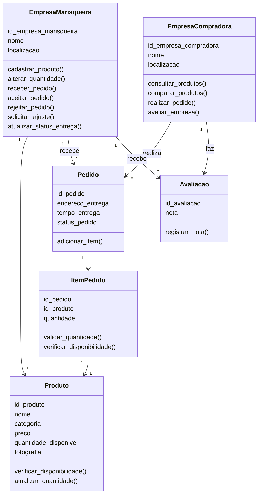

# 🦐 Marisqueiras da Ilha

<p align="center">
  
  
  
</p>

<p align="center">
  
  
  
  
</p>

<p align="center">
  Plataforma <b>B2B</b> de venda direta de mariscos entre <b>empresas das marisqueiras</b> e <b>empresas compradoras</b>, implementada em <b>Python</b> com <b>Programação Orientada a Objetos</b>.
</p>

---

## 📖 Índice

- [Sobre o projeto](#-sobre-o-projeto)
- [Contexto](#-contexto)
- [Funcionalidades](#-funcionalidades)
- [Regras de negócio](#-regras-de-negócio)
- [Tecnologias utilizadas](#-tecnologias-utilizadas)
- [Pré-requisitos](#-pré-requisitos)
- [Instalação](#-instalação)
- [Como executar](#-como-executar)
- [Testes](#-testes)
- [Usando o menu](#-usando-o-menu)
- [Fluxo de exemplo](#-fluxo-de-exemplo)
- [Estrutura do projeto](#-estrutura-do-projeto)
- [Modelo de classes](#-modelo-de-classes)
- [Decisões de modelagem](#-decisões-de-modelagem)
- [Fora do escopo](#-fora-do-escopo)
- [Possíveis melhorias](#-possíveis-melhorias)
- [Contribuição](#-contribuição)
- [FAQ](#-faq)
- [Licença](#-licença)
- [Autor](#-autor)
- [Agradecimentos](#-agradecimentos)

---

## 📌 Sobre o projeto

O **Marisqueiras da Ilha** é uma plataforma **B2B** (business-to-business) de venda direta de mariscos entre **empresas das marisqueiras** e **empresas compradoras**. Foi implementado em **Python** com forte uso de **Programação Orientada a Objetos**, como atividade prática da disciplina de POO da **UNDB** (metodologia **PjBL** — *Project Based Learning*).

A plataforma **não vende ao consumidor final**: atende exclusivamente **empresas**, cada uma associada a uma habitação da comunidade. Toda a operação — cadastro de produtos, consulta, pedidos, fornecimento e entrega — é organizada de ponta a ponta pelo sistema.

O projeto é executado no **terminal**, por meio de um **menu interativo** (`main.py`) ou de uma **demonstração automática** (`demo.py`), e possui **testes automatizados** com `pytest`.

---

## 🌊 Contexto

As **marisqueiras da Vila Maresia**, em **Raposa (MA)**, enfrentam dificuldades para vender diretamente: dependem de **intermediários** e não possuem mecanismos comerciais formais. Este sistema organiza a **oferta de produtos**, a **consulta**, os **pedidos**, o **fornecimento** e a **entrega** entre empresas.

Características do modelo:

- 🏢 **Modelo B2B** — atende somente empresas, nunca o consumidor final.
- 🏠 **Cada habitação** da comunidade corresponde a uma **empresa**.
- 🚚 **A entrega é feita pela própria marisqueira**, sem rastreamento em tempo real.

---

## ✨ Funcionalidades

### 🐟 Empresa marisqueira

- **Cadastrar produtos** (fresco e congelado são produtos diferentes)
- **Alterar a quantidade disponível**
- **Receber pedidos** e **aceitar**, **rejeitar** ou **solicitar ajuste**
- **Atualizar o status da entrega**: em preparo → em curso → finalizado
- **Ver a situação da empresa** (verde, laranja, vermelho) e a **média das avaliações**

### 🛒 Empresa compradora

- **Consultar produtos** com filtros (nome, categoria, localização, empresa, avaliação mínima)
- **Ordenar** por menor preço, maior preço, melhor avaliação ou proximidade
- **Comparar produtos** de empresas diferentes
- **Realizar pedidos** com vários produtos
- **Avaliar a marisqueira** de 1 a 5 estrelas após a entrega

---

## 📜 Regras de negócio

- ⚖️ **Venda por quilograma**, com **mínimo de 25 kg por produto**
- 💰 **Não existe valor mínimo em dinheiro**
- 📦 A quantidade pedida **não pode ultrapassar o estoque**
- 🧾 Um pedido pode ter vários produtos, mas **todos da mesma marisqueira**
- 💲 O preço é definido por produto e empresa e fica **fixado no pedido**
- 📉 Com estoque zero, o produto continua cadastrado e aparece como **indisponível**
- 🔄 O estoque só é descontado quando a marisqueira **aceita** o pedido
- ⭐ Só é possível avaliar um pedido **finalizado**, e **uma única vez por pedido**
- 🏷️ O **CNPJ** das empresas é validado (14 dígitos e dígitos verificadores)
- 💳 **Pagamento fora do escopo** — o custo da entrega já está embutido no preço

---

## 🛠️ Tecnologias utilizadas

| Tecnologia | Descrição |
|------------|-----------|
| **Python 3.9+** | Linguagem principal do projeto |
| **Programação Orientada a Objetos** | Modelagem de domínio com classes, herança e encapsulamento |
| **pytest** | Framework de testes automatizados |

> O projeto **não utiliza bibliotecas externas** para rodar — apenas o `pytest` para executar os testes.

---

## 📋 Pré-requisitos

- **Python 3.9** ou mais novo
- **pip** (já incluso na instalação do Python)
- **pytest** (opcional, necessário apenas para rodar os testes)
- (Opcional) **Git** instalado, caso queira clonar o repositório

Nenhuma outra dependência é necessária.

---

## 🚀 Instalação

```bash
# Clone o repositório
git clone https://github.com/LucKsz001/marisqueiras-da-ilha.git

# Entre na pasta do projeto
cd marisqueiras-da-ilha
```

---

## ▶️ Como executar

```bash
python main.py      # menu interativo no terminal
python demo.py      # exemplo completo automático
```

> 💡 **Dica de sistema operacional:**
> - 🪟 **Windows:** se `python` não funcionar, use `py main.py`
> - 🍎🐧 **Mac e Linux:** use `python3 main.py`

---

## 🧪 Testes

O projeto possui uma suíte de testes automatizados com `pytest`, um arquivo por unidade do domínio.

```bash
# Instalar o pytest (caso ainda não tenha)
pip install pytest

# Executar os testes
pytest -v
```

---

## 🖥️ Usando o menu

O programa abre um **menu numerado**: digite o número da opção e aperte **Enter**. O `0` sempre volta ao menu anterior (ou sai, no menu principal).

```text
============================================================
 MENU PRINCIPAL
============================================================
  1 - Entrar como Empresa Marisqueira
  2 - Entrar como Empresa Compradora
  3 - Cadastrar nova empresa
  0 - Sair
```

> 📦 O sistema **já vem com dados de exemplo**:
> - 2 marisqueiras (**Maria** e **Ana**)
> - 5 produtos cadastrados
> - 1 restaurante comprador
>
> ⚠️ Os dados ficam **apenas na memória** e são reiniciados ao fechar o programa.

---

## 🎬 Fluxo de exemplo

1. Menu principal → `2` (compradora) → `1` (Restaurante Mar Azul) → `3` (Realizar pedido)
2. Digite `1 50` (50 kg do produto de código 1), depois `3 25`, e **Enter em linha vazia** para terminar
3. Informe **endereço** e **tempo de entrega** — o pedido vai para a marisqueira
4. Volte ao menu principal → `1` (marisqueira) → `1` (Maria) → `5` (Aceitar pedido)
5. Na mesma tela, use `8` para mudar o status para **em curso** e depois **finalizado**
6. Como compradora, use `5` para **avaliar** a marisqueira

> ⚠️ **Violações de regra** (menos de 25 kg, estoque insuficiente, produtos de marisqueiras diferentes, CNPJ inválido) exibem uma **mensagem de erro** e o programa **continua executando** normalmente.

---

## 📁 Estrutura do projeto

```text
marisqueiras-da-ilha/
├── main.py                    # menu interativo
├── demo.py                    # demonstração automática
├── conftest.py                # fixtures dos testes
├── pytest.ini                 # configuração do pytest
├── requirements.txt           # dependências do projeto
├── LICENSE                    # licença do projeto (MIT)
├── README.md                  # documentação
│
├── marisqueiras_da_ilha/      # pacote principal (domínio)
│   ├── empresa_marisqueira.py
│   ├── empresa_compradora.py
│   ├── produto.py
│   ├── pedido.py
│   ├── item_pedido.py
│   ├── avaliacao.py
│   ├── enums.py               # categoria, status do pedido, situação
│   ├── excecoes.py            # erros de regra de negócio
│   ├── constantes.py          # 25 kg mínimo, limite de estoque baixo
│   ├── validacao.py           # validação de CNPJ
│   └── cli.py                 # menus do terminal
│
└── tests/                     # testes pytest, um arquivo por unidade
```

---

## 🧩 Modelo de classes



---

## 🧠 Decisões de modelagem

Pontos que o documento de requisitos deixou em aberto e que foram **resolvidos na implementação**:

- **Status do pedido:** `status_pedido` (em preparo, em curso, finalizado) só existe **depois do aceite**. A fase de análise (aguardando, aceito, rejeitado, ajuste solicitado) fica em um campo separado, `analise`.
- **Entrega em ordem:** o status **só avança um passo por vez**, sem pular nem voltar.
- **Avaliações:** o documento não define a cardinalidade, então há **no máximo uma avaliação por pedido**.
- **Situação da empresa:** 🔴 vermelho fora do horário (padrão das 6h às 18h); 🟠 laranja com menos de 100 kg no total; 🟢 verde nos demais casos. O limite de 100 kg e o horário são **escolhas de implementação**.
- **Proximidade:** sem coordenadas geográficas, a ordenação coloca primeiro as empresas da **mesma localização** da compradora.
- **Quantidade ao cadastrar:** exige pelo menos **25 kg**. Depois, a marisqueira pode alterar para **qualquer valor a partir de zero**.

---

## 🚫 Fora do escopo

- 💳 **Pagamento** (o custo da entrega já está embutido no preço)
- 📍 **Rastreamento** de entrega em tempo real
- 🌐 **Versão web**
- 🗄️ **Banco de dados** (os dados ficam em memória)
- 🔍 **Rastreabilidade** de origem e qualidade dos mariscos (possibilidade futura)

---

## 🔧 Possíveis melhorias

- [ ] Persistência em banco de dados (SQLite, PostgreSQL)
- [ ] Interface web com Flask ou Django
- [ ] API REST para integração com outros sistemas
- [ ] Autenticação de empresas (login e senha)
- [ ] Histórico completo de pedidos e avaliações
- [ ] Rastreamento de entrega em tempo real
- [ ] Rastreabilidade de origem e qualidade dos mariscos
- [ ] Relatórios e dashboards para as marisqueiras
- [ ] Módulo de pagamento integrado
- [ ] Cobertura de testes ampliada com `pytest-cov`

---

## 🤝 Contribuição

Contribuições são **muito bem-vindas**! Para contribuir:

1. Faça um **fork** do projeto.
2. Crie uma **branch** para sua feature:
   ```bash
   git checkout -b feature/minha-feature
   ```
3. Faça suas alterações e **commit**:
   ```bash
   git commit -m "feat: adiciona minha feature"
   ```
4. Faça **push** para sua branch:
   ```bash
   git push origin feature/minha-feature
   ```
5. Abra um **Pull Request** no repositório original.

### 📝 Padrão de commits (sugestão)

Utilize [Conventional Commits](https://www.conventionalcommits.org/pt-br/):

- `feat:` nova funcionalidade
- `fix:` correção de bug
- `docs:` documentação
- `style:` formatação/estilo
- `refactor:` refatoração
- `test:` testes
- `chore:` tarefas de manutenção

---

## ❓ FAQ

**1. Preciso instalar algo para rodar o projeto?**
Apenas o **Python 3.9+**. Para os testes, também o `pytest`.

**2. Posso vender para pessoa física?**
Não. O sistema é **B2B** e atende **exclusivamente empresas**.

**3. Os dados são salvos ao fechar o programa?**
Não. Os dados ficam **apenas em memória** e são reiniciados a cada execução.

**4. Posso pedir menos de 25 kg de um produto?**
Não. A regra de negócio exige **mínimo de 25 kg por produto**.

**5. Como avaliar uma marisqueira?**
Apenas após o pedido estar com status **finalizado**, e **uma única vez por pedido**.

**6. O projeto tem versão web?**
Não, está **fora do escopo** atual. É executado apenas no **terminal**.

**7. Como rodar os testes?**
Basta instalar o `pytest` (`pip install pytest`) e rodar `pytest -v` na raiz do projeto.

**8. Posso usar o código em outros projetos?**
Sim! O projeto está sob a **Licença MIT**, que permite uso, modificação e redistribuição livremente, desde que mantido o aviso de copyright.

---

## 📄 Licença

Este projeto está licenciado sob a **Licença MIT** — veja o arquivo [LICENSE](LICENSE) para mais detalhes.

Resumo da licença: você pode **usar, copiar, modificar, mesclar, publicar, distribuir, sublicenciar e/ou vender** o software livremente, desde que mantenha o aviso de copyright original.

---

## 👤 Autor

Desenvolvido com 💙 por **Pedro Lucas (LucKsz001)** como atividade de **Programação Orientada a Objetos — UNDB (PjBL)**.

- 🐙 GitHub: [@LucKsz001](https://github.com/LucKsz001)
- 💼 LinkedIn: [Pedro Lucas](https://www.linkedin.com/in/pedro-lucas-b66187349)
- 📧 Email: [pedrolucas19souza@gmail.com](mailto:pedrolucas19souza@gmail.com)

---

## 🙏 Agradecimentos

- À **UNDB** pela proposta do projeto em formato **PjBL**;
- Às **marisqueiras da Vila Maresia**, que inspiraram o domínio do sistema;
- À comunidade **open source** por tornar o aprendizado acessível;
- A você, que está lendo este README — obrigado pelo interesse! 🚀

---

<p align="center">
  <i>Feito com dedicação, Python e café ☕</i>
</p>

<p align="center">
  ⭐ <b>Se este projeto te ajudou de alguma forma, deixe uma estrela no repositório!</b> ⭐
</p>
