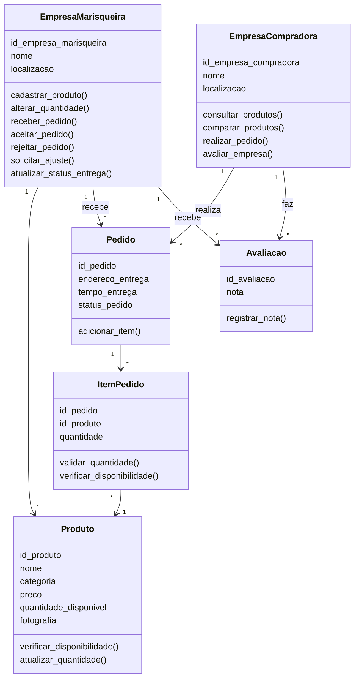

# Marisqueiras da Ilha

Plataforma B2B de venda direta de mariscos entre **empresas das marisqueiras** e **empresas compradoras**, implementada em Python com Programação Orientada a Objetos. Projeto da atividade de POO (UNDB, PjBL).

---

## Sobre o projeto

As marisqueiras da Vila Maresia, em Raposa (MA), têm dificuldade para vender direto: dependem de intermediários e não têm mecanismos comerciais formais. Este sistema organiza a oferta de produtos, a consulta, os pedidos, o fornecimento e a entrega entre empresas.

- Modelo **B2B**: atende só empresas, não o consumidor final.
- Cada habitação da comunidade corresponde a uma empresa.
- A entrega é feita pela própria marisqueira, sem rastreamento em tempo real.

---

## Funcionalidades

### Empresa marisqueira
- Cadastrar produtos (fresco e congelado são produtos diferentes)
- Alterar a quantidade disponível
- Receber pedidos e **aceitar**, **rejeitar** ou **solicitar ajuste**
- Atualizar o status da entrega: em preparo, em curso, finalizado
- Ver a situação da empresa (verde, laranja, vermelho) e a média das avaliações

### Empresa compradora
- Consultar produtos com filtros (nome, categoria, localização, empresa, avaliação mínima)
- Ordenar por menor preço, maior preço, melhor avaliação ou proximidade
- Comparar produtos de empresas diferentes
- Realizar pedidos com vários produtos
- Avaliar a marisqueira de 1 a 5 estrelas após a entrega

---

## Regras de negócio implementadas

- Venda por quilograma, com **mínimo de 25 kg por produto**
- Não existe valor mínimo em dinheiro
- A quantidade pedida **não pode ultrapassar o estoque**
- Um pedido pode ter vários produtos, mas **todos da mesma marisqueira**
- O preço é definido por produto e empresa e fica fixado no pedido
- Com estoque zero, o produto continua cadastrado e aparece como **indisponível**
- O estoque só é descontado quando a marisqueira **aceita** o pedido
- Só é possível avaliar um pedido **finalizado**, uma vez por pedido
- O CNPJ das empresas é validado (14 dígitos e dígitos verificadores)
- Pagamento fora do escopo; o custo da entrega já está embutido no preço

---

## Requisitos

- Python 3.9 ou mais novo
- Nenhuma biblioteca externa para rodar (só o `pytest` para os testes)

---

## Como executar

```bash
git clone https://github.com/SEU-USUARIO/marisqueiras-da-ilha.git
cd marisqueiras-da-ilha

python main.py      # menu interativo no terminal
python demo.py      # exemplo completo automático
```

> No Windows, se `python` não funcionar, use `py main.py`. No Mac e no Linux, use `python3 main.py`.

### Testes

```bash
pip install pytest
pytest -v
```

---

## Usando o menu

O programa abre um menu numerado: digite o número da opção e aperte Enter. O `0` sempre volta ao menu anterior (ou sai, no menu principal).

```
============================================================
 MENU PRINCIPAL
============================================================
  1 - Entrar como Empresa Marisqueira
  2 - Entrar como Empresa Compradora
  3 - Cadastrar nova empresa
  0 - Sair
```

Já vem com dados de exemplo: duas marisqueiras (Maria e Ana), cinco produtos e um restaurante comprador. Os dados ficam só na memória e são reiniciados ao fechar o programa.

### Fluxo de exemplo

1. Menu principal → `2` (compradora) → `1` (Restaurante Mar Azul) → `3` (Realizar pedido)
2. Digite `1 50` (50 kg do produto de código 1), depois `3 25`, e Enter em linha vazia para terminar
3. Informe endereço e tempo de entrega. O pedido vai para a marisqueira
4. Volte ao menu principal → `1` (marisqueira) → `1` (Maria) → `5` (Aceitar pedido)
5. Na mesma tela, use `8` para mudar o status para **em curso** e depois **finalizado**
6. Como compradora, use `5` para avaliar a marisqueira

Violações de regra (menos de 25 kg, estoque insuficiente, produtos de marisqueiras diferentes, CNPJ inválido) mostram uma mensagem de erro e o programa continua.

---

## Estrutura do projeto

```
marisqueiras-da-ilha/
├── main.py                    # menu interativo
├── demo.py                    # demonstração automática
├── conftest.py                # fixtures dos testes
├── pytest.ini
├── requirements.txt
├── marisqueiras_da_ilha/
│   ├── empresa_marisqueira.py
│   ├── empresa_compradora.py
│   ├── produto.py
│   ├── pedido.py
│   ├── item_pedido.py
│   ├── avaliacao.py
│   ├── enums.py               # categoria, status do pedido, situação
│   ├── excecoes.py            # erros de regra de negócio
│   ├── constantes.py          # 25 kg mínimo, limite de estoque baixo
│   ├── validacao.py           # validação de CNPJ
│   └── cli.py                 # menus do terminal
└── tests/                     # testes pytest, um arquivo por unidade
```

---

## Modelo de classes



---

## Decisões de modelagem

Pontos que o documento de requisitos deixou em aberto:

- **Status do pedido:** `status_pedido` (em preparo, em curso, finalizado) só existe depois do aceite. A fase de análise (aguardando, aceito, rejeitado, ajuste solicitado) fica em um campo separado, `analise`.
- **Entrega em ordem:** o status só avança um passo por vez, sem pular nem voltar.
- **Avaliações:** o documento não define a cardinalidade, então há no máximo uma avaliação por pedido.
- **Situação da empresa:** vermelho fora do horário (padrão das 6h às 18h), laranja com menos de 100 kg no total e verde nos demais casos. O limite de 100 kg e o horário são escolhas de implementação.
- **Proximidade:** sem coordenadas geográficas, a ordenação coloca primeiro as empresas da mesma localização da compradora.
- **Quantidade ao cadastrar:** exige pelo menos 25 kg. Depois, a marisqueira pode alterar para qualquer valor a partir de zero.

---

## Fora do escopo

Pagamento, rastreamento de entrega em tempo real, versão web, banco de dados (os dados ficam em memória) e rastreabilidade de origem e qualidade dos mariscos (possibilidade futura).

---

## Autor

Desenvolvido como atividade de Programação Orientada a Objetos — UNDB (PjBL).

## Licença

Este projeto está sob a licença MIT. Consulte o arquivo [LICENSE](LICENSE) para mais detalhes.